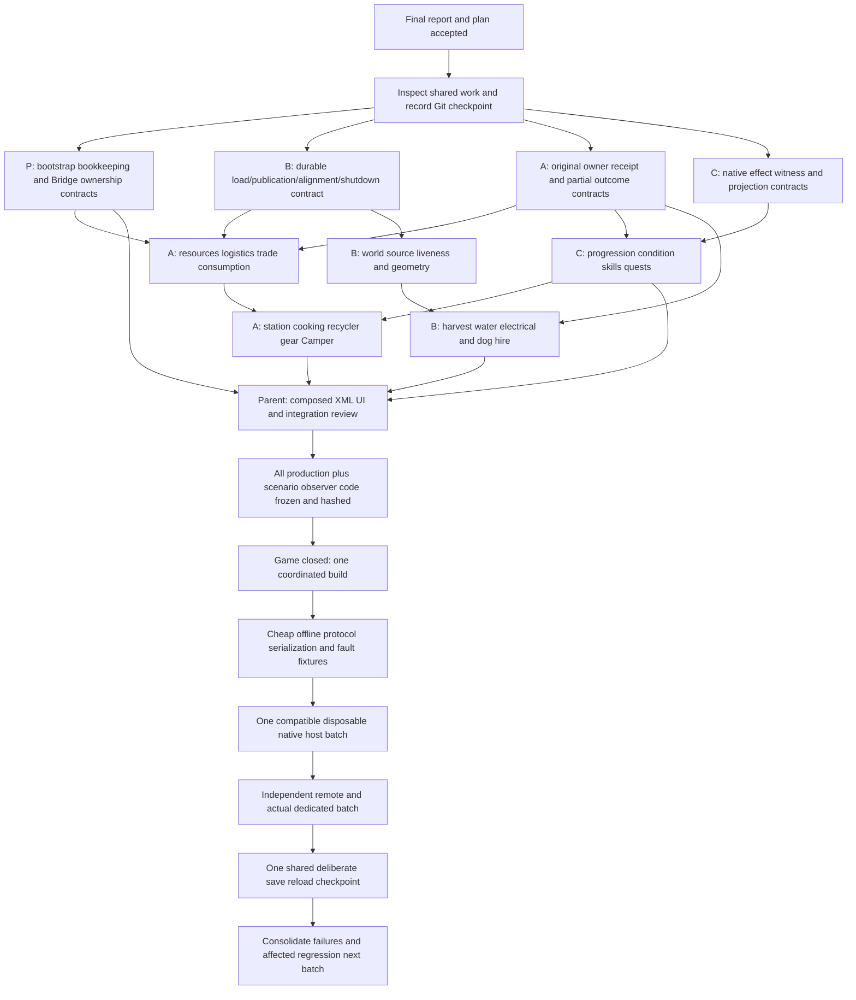

# Implementation dependency order — three-agent draft

2026-10-15. Planning only; no production/build/game/tests. Covers MP001–088 exactly once as accountable package ownership below. This is a proposed executable schedule, not new authorization or actual file claims. Parent finalizes report/plan, inspects shared changes and records checkpoint before any coding. Existing FINAL_PLAN_COVERAGE matrices, dedicated PLAN_GAPS and transaction review retain every acceptance assertion; scheduling does not narrow scope.

## Exclusive lanes and accountable findings

Parent P owns common bootstrap/patch bookkeeping, Bridge infrastructure, shared interface integration and final manifests. Coding agent A owns native owner inventory/crafting/mobile transactions and their directly coupled UI/projection. Coding agent B owns world/farming/fire/electrical plus NPC durable stores/lifecycle. Coding agent C owns Survivor progression/native effect witness, quest/party and authored NPC behavior/presentation outside A/B shared files. Each lane writes all its production and scenario/observer code before tests. No lane runs an independent build/game/test during coding.

|Lane|Accountable MP IDs (each once)|Work is sequential inside lane where files overlap|
|---|---|---|
|P|003,004,013,014,017,025,026,061|Installer/cache/error semantics; trusted Bridge endpoint/cancellation/fixtures; harmless diagnostics isolation. Shared wire/bootstrap integration requests from A/B/C are applied only by P.|
|A|001,005,006,007,008,009,010,018,027,028,029,030,031,037,040,041,042,043,047,048,050,054,055,056,059,066,068,069,070,071,072,073,074,083,084,085,086,087|Owner receipts/remote resources first; shared NPC transfer/trade/companion action file next; station output/tool/clock; Camper and gear; shared native stat owner correction; presentation last.|
|B|002,011,012,016,020,021,022,023,024,032,033,034,035,036,038,039,044,045,046,049,057,079,088|Coherent durable-state/load barrier before domain mutation; world lifecycle cleanup; geometry/source liveness; original harvest; Camper runtime native controls.|
|C|015,019,051,052,053,058,060,062,063,064,065,067,075,076,077,078,080,081,082|Native owner projection/effect identity, staged progression and exact hook registration contract; quests/party; domain actions/creator; no direct shared NPC/owner file edits outside assigned boundaries.|

Accountability means one person tracks completion; supporting file changes stay with their exclusive file owner. Thus C081 specifies admin semantic repair but B owns store/cache APIs and P owns shared AdminSupport changes also used by061; A040 needs B electrical source adapter; B035 needs A owner receipt adapter; C015 needs A station completion integration. These are explicit interfaces, not duplicate edits.

## Dependency DAG and release gates

Edges are readiness requirements at affected call boundaries, not permission for a lane to run tests early. Independent text/implementation work may continue while a prerequisite contract is drafted. P0/A0/B0/C0 produce reviewed signatures, states/outcomes and compatibility policy; consumers do not silently guess. Any unresolved native fact is researched read-only during coding preparation, not replaced by a mock assumption.

## Concrete coding order within the graph

1. P fixes retryable staged install/shared patch-cache truth (004/013/017), and defines the exact targeted registrations requested for065/078 and current supported hooks. Tool guards already register through ProgressionInstaller33–35: do not add duplicate RecyclerInstaller hooks. P also writes Bridge request/world/player generation ownership, whole-operation cancellation/cleanup, endpoint validation, fixture preflight and truthful completion observers (003/014/025/026/061). Production and scenario code together, no execution.
2. B establishes semantic load quarantine, durable publication/outcome, current save/world generation and failed alignment/shutdown retention (011/012/021/023/036/045/046/049/081 support). Domain cleanup cannot clear failure-held originals. Preserve false WorkReleaseGate and WorkCustody originals; no work feature activation. C019 uses agreed store contract in metabolism repository.
3. A defines original immutable intent, relevant native before/after or deltas, committed/unknown legs, remainder, terminal query and hold release for existing compatible owner operations (007–010/018/031/040/047/048/068/072/073/074). No global authority rewrite, no whole server replica bag replacement, no new universal fsync phase. B/C supply source revisions/effect witnesses. Resolve phase0 owner intent, overflow identity and replacement live actor/session binding before dependent application code.
4. Implement A resource/logistics/NPC transaction adapters and C consumption/effect interfaces before A station/refund producers. Keep separate logical NPC Transfer authority contract047; no Transfer=>arbitraryMutate. A owns both legacy006 and modern072 producers; shared helpers do not erase their separate assertions. Trade quote legs048/050 and CompanionService043/083/084 are edited sequentially by A.
5. Implement C original progression/native upload/effect witnesses and projection (015/051/062–067/075–077/080/085 support) and B exact world source incarnation/liveness/geometry (020/024/032–035/038/039/088). Kill witness063 and actual frame drain065 are independent requirements. Explosion077 observes accepted native change, not attempted candidate. C058 tests authored class route only; missing natural population is not enabled. B079 preserves native driver/seat ownership.
6. A station queue/output/refund/tools/cooking work (027–029/041/042/054–056), then mobile restoration/sink/close/relocation (030/031/069/071/073), gear074/068 and repair/heat stat correction066/085. Freeze original output definitions before station-area rewrite and old ticket compatibility policy. Queue16/all outputs/four scrap stations retained. Ordinary required tools degrade only where native degradation exists; nondurable authoring unchanged. B044 hire uses coherent durable compensation, not runtime refund behind committed owner save.
7. C quest052/053/060 and creator082; P/B integrate admin080/081 and diagnostics061. A finishes UI category001/toolbelt059/drone083/recall084/navigation086/inspector087. Common navigation XML extracted once for both modes; indicator mapping preserves exact selected/held native stack and requested white centered enlarged quality number. No visual PASS before screenshots.
8. Parent integrates all file-owner receipts, checks composed XML/include mode behavior, schema/native wire compatibility and exact native hook coverage, prepares actual endpoint deployment manifest and scenario roster. Six-seat asset handoff remains HOLD until exact reviewed deltas/bundle and native composition/restoration are integrated; coordinate existing external asset owner, never install old cabin-only bundle.

## File collision register — one writer until explicit handoff

|Collision set|Exclusive writer|Consumers and contract rule|
|---|---|---|
|Scripts/Patching/Core/RebirthHarmonyBootstrap.cs; Scripts/Bootstrap/RebirthFresh_Init.cs; Scripts/Survivor/RebirthSurvivorInstaller.cs; Progression/RebirthSurvivorProgressionInstaller.cs|P|All lanes send precise registration request/type/priority/required readiness; P applies once and reports actual staged status. No temporary second installer.|
|Scripts/GameBridge/**; Tools/GameBridge shared runner/config/test schema; aggregate report/index|P|A/B/C may write uniquely named domain scenario files only after P reserves filenames/schema. Shared fixture/observation implementation P; guard ON. No self-run or startup over user game.|
|Scripts/Companions/RebirthCompanionService.cs and RebirthCompanionWindow.cs|A|043/048/083/084 and C076/078 integration needs overlap. C sends domain state/guard/API contract; A applies shared file changes. Split other disjoint dog behavior files only by named path.|
|Scripts/NPC/Inventory/RebirthNpcInventoryTransactions.cs; RebirthNpcExternalInventoryGateway.cs; RebirthNpcInventoryAuthority.cs; Scripts/QuickStack/LogisticsTransferService.cs|A|040/041/043/047/048/072 consumers use narrow transaction API and original revision/outcome. B persistent-store changes via contract; C cannot bypass source lease.|
|Scripts/NPC/Persistence/** and Scripts/NPC/Foundation/RebirthNpcLifecycle.cs; Dog/RebirthDogLifecycleService.cs|B|044/045/046/049 and C081 cache-repair/078 detach need coordinated API. C owns other explicit dog hook file only once B/P confirms no shared edit. Keep release-held WorkRuntime inactive.|
|Scripts/NPC/Administration/RebirthNpcAdministrationSupport.cs and related shared Inspect/repair dispatcher|P|061 harmless diagnostics and081 repair share file. B supplies full semantic validation/cache API; C supplies requested admin outcome contract. No real repair execution.|
|Scripts/Crafting/RemoteCrafting/**; Scripts/Crafting/Recycling/**; station preparation/refund/completion helpers and persisted station records in Scripts/Survivor/Persistence|A|B owns generic store support but not these station schema edits. C015/062 sends award/durable-outcome contract. Parent arbitrates any Repository shared method touch.|
|Scripts/Metabolism/Consumption/** and action producer; RebirthMetabolismService.cs|A|C019 owns repository/config recovery only; C051 owner scalar/condition logic uses agreed current scope. A coordinates043 external ingestion,007/018 original source and NPC return.|
|Scripts/Survivor/Network/RebirthSurvivorNetworkService.cs and shared snapshot/schema model; Repository shared serialization/common record|P|C051/064/075/076/080 and A066/068/085 send additive versioned fields/current-scope contracts. Domain files remain A/C; P controls common wire/store integration to avoid lost fields.|
|Scripts/Survivor/Support gear inbox/original/terminal/owner holds; repair/provenance owner correction shared helper|A|074/068/066/085 edit sequentially. C owns pure award calculation and emits exact native fields; A owns owner application. No arbitrary sibling match.|
|Scripts/Vehicles/Camper/** and Scripts/Vehicles/Restoration/**|A except B016energy lookup/B079cruise separate actual Input file|B016 edits EnergyCustody/journal index only via named exclusive handoff if A031/069 source route needs same file. A's active ownership wins until handoff; never parallel wildcard assumption. Parent integrates asset-produced deltas.|
|Scripts/AdvancedFarming/**, relevant world/fire/electrical stores|B|A024/035 receipt helper support separate files. P owns diagnostic shared timing/runner; B supplies domain adapters and may own unique diagnostics files only by explicit path.|
|Config/XUi_InGame/templates.xml, station_templates.xml; Config/_Vehicles/camper_*windows.xml and common Camper template|A XML integrator|086/087 plus station/cooking changes are serial; C UI/profile XML disjoint files unless same shared root. Parent owns include/root merge when multiple authors need it.|

Wildcard sets describe default reservation only. Before coding parent inventories exact changed paths and publishes concrete claims; a lane must not touch an exception/shared root merely because its broader folder is listed. Completed handoff includes exact changed file/hash, API/compatibility decisions and unexecuted scenario IDs. No agent compensates for an unavailable contract by an alternate local implementation.

## Research blockers resolved before dependent code freezes

Native overflow/drop identity for073 and partial native output; legacy ticket055 frozen extras migration; sink031 durable unattempted owner proof; repaired sibling066/085 original output identity; ordinary054 productive-time/tool modifier boundary; trade048 per-leg stock/currency outcome. Parent controls scope/facts, uses existing exact native inspector read-only as needed, no guessed behavior or user redesign request for an inspectable fact. Missing-template086 is EmptyView not fatal;087 is unmapped indicators, not stale-inspector.088 is medium scoped stale provider boundary, not observed permanent water duplication.

## Final gate and failure iteration

All source/scenario/observer code must be finished across P/A/B/C before any test/build/game. Parent reviews current hashes, no unowned file edits, included XML/public templates, release/debug guards, native wire envelope and one-time operation lifecycle. One game-closed build, then cheap offline fixtures; compatible native host batch, real independent remote/dedicated topology where available, then shared deliberate reload. Mocks/single-player cannot PASS remote. A failed input timeout is unknown outcome, not permission to replay. Stop dependent conservation tests on unresolved custody; collect independent failures. Next coding batch addresses consolidated failures and reruns only affected/shared-risk scenarios. No task here authorizes early feature tests, weakening guards, deleting held evidence, or reducing any001–088 acceptance requirement.

